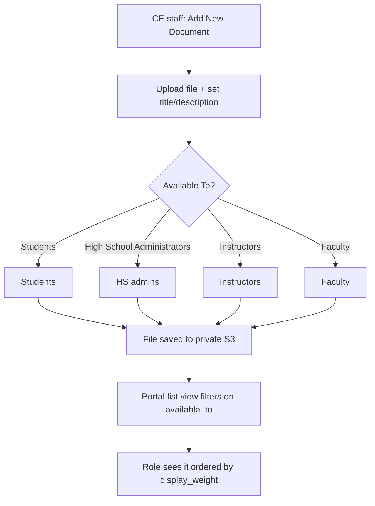
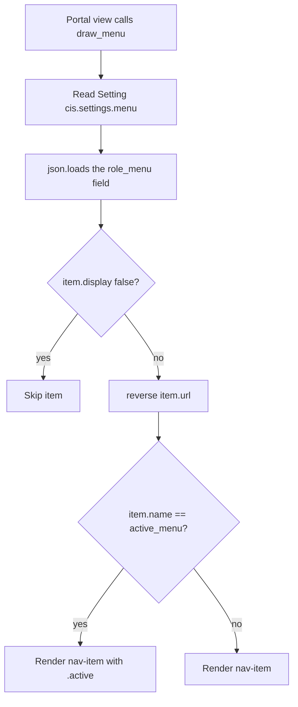

# MyCE — Document Repository (`docrepo`)

Shared document library for the MyCE concurrent-enrollment platform. CE staff upload files
into private S3 storage and tag which portal roles may see them; each role portal renders a
read-only, download-only list.

- **Package name:** `myce_docrepo`
- **Import name:** `docrepo`
- **Repo:** <https://github.com/Canusia/package-docrepo>
- **Current tag:** `v0.0.2`

## Overview

`docrepo` is a single-model app. A `DocRepo` record holds a title, a rich-text description,
a file, a display weight, and an `available_to` multi-select naming the portal roles allowed
to see it. CE staff get full CRUD at `/ce/documents/`; the student, instructor, faculty and
high-school-admin portals each get a filtered read-only list at `<portal>/documents/`.

Files are stored on `cis.storage_backend.PrivateMediaStorage` (private S3) under
`docrepo/<uuid>/<filename>` — they are never public-readable, and the portal templates link
through the storage backend's signed URL.



## Installation

### Production (pip)

Add to `webapp/requirements.txt`:

```
git+https://github.com/Canusia/package-docrepo.git@v0.0.2
```

### Development (git submodule)

```bash
git submodule add https://github.com/Canusia/package-docrepo.git webapp/docrepo
cd webapp/docrepo && git checkout v0.0.2
```

### Host wiring

Both layouts are selected at runtime, so the same host code works in dev and production.

In `webapp/myce/settings.py`, inside `INSTALLED_APPS`:

```python
'docrepo.docrepo.apps.DevDocRepoConfig'
if importlib.util.find_spec('docrepo.docrepo')
else 'docrepo.apps.DocRepoConfig',
```

In `webapp/myce/urls.py`, define the prefix alias **above** the main `urlpatterns` list
(next to the other `_rep` / `_pde` / `_cv` aliases):

```python
_dr = 'docrepo.docrepo' if importlib.util.find_spec('docrepo.docrepo') else 'docrepo'
```

Then mount the portals you need:

```python
path('ce/documents/',               include(f'{_dr}.urls.ce')),
path('instructor/documents/',       include(f'{_dr}.urls.instructor')),
path('student/documents/',          include(f'{_dr}.urls.student')),
path('faculty/documents/',          include(f'{_dr}.urls.faculty')),
path('highschool_admin/documents/', include(f'{_dr}.urls.highschool_admin')),   # see Known Gaps
```

The package ships **no** `staticfiles/` directory — nothing to add to `STATICFILES_DIRS`.

### Dev vs production layout

| | Dev (submodule) | Production (pip) |
|---|---|---|
| On-disk path | `webapp/docrepo/docrepo/` | `site-packages/docrepo/` |
| Import prefix | `docrepo.docrepo` | `docrepo` |
| App config | `DevDocRepoConfig` | `DocRepoConfig` |
| Django app label | `docrepo` | `docrepo` |
| DB table | `docrepo_docrepo` | `docrepo_docrepo` |

The app label is identical in both layouts because Django derives it from the last dotted
component of `AppConfig.name`. **Never set an explicit `label`, and never rename the inner
directory** — both would orphan the existing `docrepo_docrepo` table and the applied
`('docrepo', '0001_initial')` migration row on every live deployment.

All intra-package imports are relative (`from ..models.model import DocRepo`). An absolute
`from docrepo.models…` resolves only in the 2-deep dev layout and silently breaks the pip
install.

## Model reference

`DocRepo` — `docrepo/models/model.py`

| Field | Type | Notes |
|---|---|---|
| `id` | `UUIDField` | Primary key, `uuid4`, not editable |
| `title` | `CharField(100)` | Shown as the link text in every portal |
| `description` | `HTMLField` (TinyMCE) | Rich text, rendered under the title |
| `available_to` | `MultiSelectField(300)` | One or more of `Students`, `High School Administrators`, `Instructors`, `Faculty` |
| `display_weight` | `SmallIntegerField` | Portal lists sort ascending by this |
| `media` | `FileField` | `PrivateMediaStorage`, uploaded to `docrepo/<id>/<filename>` |
| `uploaded_on` | `DateTimeField` | `auto_now` |
| `uploaded_by` | `FK → cis.CustomUser` | `PROTECT` — a user with uploads cannot be deleted |

`DocRepo.ce_url` is a property returning `reverse_lazy('docrepo:doc', …)`. The DRF serializer
exposes it via `datatables_always_serialize`, so the CE namespace **must** stay mounted as
`docrepo` even if you rename the URL prefix.

## URL reference

| Namespace | URL name | Default path | View | Guard |
|---|---|---|---|---|
| `docrepo` | `all` | `/ce/documents/` | `index` | `user_has_cis_role` |
| `docrepo` | `doc` | `/ce/documents/document/<uuid>` | `detail` | `user_has_cis_role` |
| `docrepo` | `add_new` | `/ce/documents/document/add_new` | `add_new` | `user_has_cis_role` |
| `docrepo` | `delete` | `/ce/documents/document/delete/<uuid>` | `delete` | `user_has_cis_role` |
| `docrepo` | (router) | `/ce/documents/api/` | `DocRepoViewSet` | DRF, read-only |
| `student_docrepo` | `docs` | `/student/documents/` | `show_links_for_student` | `user_has_student_role` |
| `instructor_docrepo` | `docs` | `/instructor/documents/` | `show_links_for_instructor` | `user_has_instructor_role` |
| `faculty_docrepo` | `docs` | `/faculty/documents/` | `show_links_for_faculty` | `user_has_faculty_role` |
| `highschool_admin_docrepo` | `docs` | `/highschool_admin/documents/` | `show_links_for_highschool_admin` | `user_has_highschool_admin_role` |

The namespaces are public surface — other apps and the CE DataTable reverse them by name.
Changing them is a breaking change; changing the *path prefixes* is not.

## Portal menu configuration

### How the menu works

MyCE sidebars are **settings-driven, not code-driven**. Editing the hardcoded lists in
`webapp/cis/menu.py` does nothing at runtime. Every portal's nav is a JSON array stored in
the `Setting` row with key **`cis.settings.menu`**, under a per-role field:

| Portal | Setting field | `role_name` passed to `draw_menu` |
|---|---|---|
| CE administrator | `ce_menu` | `ce` (default) |
| Student | `student_menu` | `student` |
| Instructor | `instructor_menu` | `instructor` |
| High school admin | `highschool_admin_menu` | `highschool_admin` |
| Faculty | `faculty_menu` | `faculty` |
| Applicant | `applicant_menu` | `applicant` |



Each field's value is a **JSON string** (not nested JSON) inside the setting's JSON dict — so
programmatic edits need `json.loads` on the way in and `json.dumps` on the way out. See
[Applying the change](#applying-the-change) below.

### nav-item schema

| Key | Required | Purpose |
|---|---|---|
| `type` | yes | Always `"nav-item"` for a link. `"separator"` is only valid inside `sub_menu`. |
| `name` | yes | Internal key. **Must be `docrepo`** — the views call `draw_menu(…, 'docrepo', …)`, and highlighting matches on this value. |
| `label` | yes | Visible text. Free-form; each portal traditionally uses a different wording. |
| `url` | yes (for links) | A Django URL name, resolved with `reverse()`. Must be a namespace the host actually mounted. |
| `icon` | yes | Font Awesome 5 class string, e.g. `"fas fa-fw fa-folder"`. |
| `sub_menu` | no | Array of child items — omit for docrepo, it is a flat link in every portal. |
| `display` | no | Set `false` to hide the item without deleting it. Defaults to `true`. |
| `image` | no | Optional themed SVG name, used by a few items instead of an icon. |

`draw_menu` calls `reverse(item['url'])` inside a `try/except` that only prints the exception.
A URL name the host has not mounted therefore produces a **malformed, truncated `<a>` tag** —
a visibly broken sidebar rather than a clean 500. Mount the route before adding the item.

### CE administrator (`ce_menu`)

Present by default. Insert as a top-level item — conventionally between **Settings** and
**Staff**:

```json
{
   "type": "nav-item",
   "icon": "fas fa-fw fa-folder",
   "name": "docrepo",
   "label": "Documents",
   "url": "docrepo:all"
}
```

### Student (`student_menu`)

The route is mounted by default but the nav item is **not** present in the shipped default —
add it, conventionally after *My Academic Plan(s)*:

```json
{
   "type": "nav-item",
   "icon": "fas fa-fw fa-folder",
   "name": "docrepo",
   "label": "Documents",
   "url": "student_docrepo:docs"
}
```

### Instructor (`instructor_menu`)

Present by default. Insert before *Logout*:

```json
{
   "type": "nav-item",
   "icon": "fas fa-fw fa-folder",
   "name": "docrepo",
   "label": "Shared Docs.",
   "url": "instructor_docrepo:docs"
}
```

### High school admin (`highschool_admin_menu`)

> **Prerequisites — read [Known gaps](#known-gaps-and-prerequisites) first.** The route is not
> mounted by default, and the view has a bug as of `v0.0.2`. Adding this item before fixing both
> produces a broken sidebar link, then a 500 when clicked.

```json
{
   "type": "nav-item",
   "icon": "fas fa-fw fa-folder",
   "name": "docrepo",
   "label": "Documents",
   "url": "highschool_admin_docrepo:docs"
}
```

### Faculty (`faculty_menu`)

Present by default, for completeness:

```json
{
   "type": "nav-item",
   "icon": "fas fa-fw fa-folder",
   "name": "docrepo",
   "label": "Documents Library",
   "url": "faculty_docrepo:docs"
}
```

### Applying the change

**Option A — the Settings UI.** CE portal → **Settings** → the **Menu** setting. Each role has
its own textarea holding that role's JSON array. Paste the item into the array at the position
you want, keep the JSON valid, and save. Best for a one-off on a single tenant.

**Option B — the shell.** Idempotent, scriptable, and safe to re-run. This is the preferred
route for rolling the change across tenants:

```bash
docker exec -w /app/webapp django_web_ewu python manage.py shell -c "
import json
from cis.models.settings import Setting

ITEMS = {
    'ce_menu':               {'label': 'Documents',         'url': 'docrepo:all'},
    'student_menu':          {'label': 'Documents',         'url': 'student_docrepo:docs'},
    'instructor_menu':       {'label': 'Shared Docs.',      'url': 'instructor_docrepo:docs'},
    'highschool_admin_menu': {'label': 'Documents',         'url': 'highschool_admin_docrepo:docs'},
    'faculty_menu':          {'label': 'Documents Library', 'url': 'faculty_docrepo:docs'},
}

setting = Setting.objects.get(key='cis.settings.menu')

for field, spec in ITEMS.items():
    raw = setting.value.get(field)
    if not raw:
        print(f'{field}: field absent, skipped')
        continue
    try:
        items = json.loads(raw)
    except ValueError:
        print(f'{field}: not valid JSON, skipped')
        continue
    if any(i.get('name') == 'docrepo' for i in items):
        print(f'{field}: already present')
        continue
    entry = {
        'type': 'nav-item',
        'icon': 'fas fa-fw fa-folder',
        'name': 'docrepo',
        'label': spec['label'],
        'url': spec['url'],
    }
    # insert before Logout when there is one, else append
    at = next((n for n, i in enumerate(items) if i.get('name') == 'logout'), len(items))
    items.insert(at, entry)
    setting.value[field] = json.dumps(items, indent=3)
    print(f'{field}: inserted at index {at}')

setting.save()
print('done')
"
```

Verify afterwards — a menu entry pointing at an unmounted route is the most common mistake:

```bash
docker exec -w /app/webapp django_web_ewu python manage.py shell -c "
import json
from django.urls import reverse, NoReverseMatch
from cis.models.settings import Setting
value = Setting.objects.get(key='cis.settings.menu').value
for field in ['ce_menu','student_menu','instructor_menu','highschool_admin_menu','faculty_menu']:
    for item in json.loads(value.get(field) or '[]'):
        if item.get('name') != 'docrepo':
            continue
        try:
            print(f'{field}: OK  {item[\"url\"]} -> {reverse(item[\"url\"])}')
        except NoReverseMatch:
            print(f'{field}: BROKEN  {item[\"url\"]} is not mounted')
"
```

`Setting.value` is history-tracked (`simple_history`), so a bad edit can be recovered from
`HistoricalSetting`.

## Known gaps and prerequisites

| Gap | Effect | What it takes to close |
|---|---|---|
| HS-admin route not mounted | `highschool_admin_docrepo:docs` does not reverse; the sidebar item renders as broken markup | Add `path('highschool_admin/documents/', include(f'{_dr}.urls.highschool_admin')),` to `webapp/myce/urls.py` |
| `show_links_for_highschool_admin` passes the wrong role string | **`UnboundLocalError` (500)** on `/highschool_admin/documents/` — `get_documents` is called with `'High School Administrators'`, which matches none of its four branches, so `available_to` is never bound | Package fix: call `get_documents(request, 'highschool_admin')`. Requires a new tag plus a host pin bump |
| `DocRepoViewSet` has no role filter | The CE DataTable endpoint returns every document regardless of `available_to` | By design — it is mounted only under `/ce/` and gated by `user_has_cis_role`. Filtering happens in the server-rendered portal views |
| No `docrepo_blurb` for HS admin / student | Those two views render no intro paragraph; instructor and faculty do | Host-side: the blurb comes from `cis.settings.<role>_portal`, keyed `docrepo_blurb` |
| Test coverage | Only 7 packaging/URL smoke tests ship. No coverage of CE upload/edit/delete or of role filtering | Add view tests |

## Key files

| File | Purpose |
|---|---|
| `docrepo/models/model.py` | `DocRepo` model and `docrepo_upload_path` |
| `docrepo/views/views.py` | CE CRUD, the four portal list views, `get_documents`, `DocRepoViewSet` |
| `docrepo/forms/docrepo.py` | `DocRepoForm` |
| `docrepo/serializers.py` | `DocRepoSerializer` (DataTables) |
| `docrepo/urls/ce.py` | CE routes + DRF router, `app_name = 'docrepo'` |
| `docrepo/urls/{student,instructor,faculty,highschool_admin}.py` | Portal routes, one namespace each |
| `docrepo/templates/docrepo/index.html` | CE list page (DataTable) |
| `docrepo/templates/docrepo/details.html` | CE edit/delete page |
| `docrepo/templates/docrepo/add_new.html` | CE upload form |
| `docrepo/templates/docrepo/student/index.html` | Read-only list — reused by student, instructor, faculty and HS admin |
| `docrepo/apps.py` | `DocRepoConfig` (prod) and `DevDocRepoConfig` (dev) |
| `docrepo/migrations/0001_initial.py` | The only migration. Uses a relative import for `upload_to` so it loads in both layouts |

Host-side files this app depends on:

| File | Purpose |
|---|---|
| `webapp/cis/menu.py` | `draw_menu()` and the `*_MENU` role constants |
| `webapp/cis/settings/menu.py` | The `cis.settings.menu` Setting and its shipped defaults |
| `webapp/cis/storage_backend.py` | `PrivateMediaStorage` |
| `webapp/cis/utils.py` | The `user_has_*_role` guards |

## Troubleshooting

| Issue | Cause | Resolution |
|---|---|---|
| Sidebar item missing after editing `cis/menu.py` | The menu is read from the `cis.settings.menu` DB Setting; the Python lists are inert | Edit the Setting (UI or shell), not the source |
| Sidebar renders truncated / a link with no `href` | `draw_menu` swallowed a `NoReverseMatch` mid-tag — the `url` names a route the host has not mounted | Run the verification snippet above; mount the route or fix the URL name |
| Item shows but never highlights as active | `name` is not exactly `docrepo` | The views pass `'docrepo'` as `active_menu`; the `name` must match |
| `UnboundLocalError: available_to` on `/highschool_admin/documents/` | `show_links_for_highschool_admin` passes `'High School Administrators'` instead of `'highschool_admin'` | Package fix, see Known gaps |
| `TemplateDoesNotExist: docrepo/index.html` in production | Templates missing from the wheel — `packages = find:` ships only `.py` files | `MANIFEST.in` must keep `recursive-include docrepo/templates *`, and `setup.cfg` must keep `include_package_data = true` |
| `ModuleNotFoundError: docrepo.models.model` after deploy | An absolute self-import somewhere in the package; it resolves 2-deep in dev, not 1-deep in prod | Convert to a relative import (`from ..models.model import …`) |
| `makemigrations` wants a new migration for `docrepo` | Someone set an explicit `label`, renamed the inner package, or changed a field | Revert; the label must stay `docrepo` and the table `docrepo_docrepo` |
| Document uploaded but portal list is empty | `available_to` does not include that role, or the role's view was never mounted | Check the record's *Available To*, then the URL mount |
| Cannot delete a CE user | `uploaded_by` is `on_delete=PROTECT` | Reassign or delete their documents first |

## License

MIT. See `LICENSE`.
